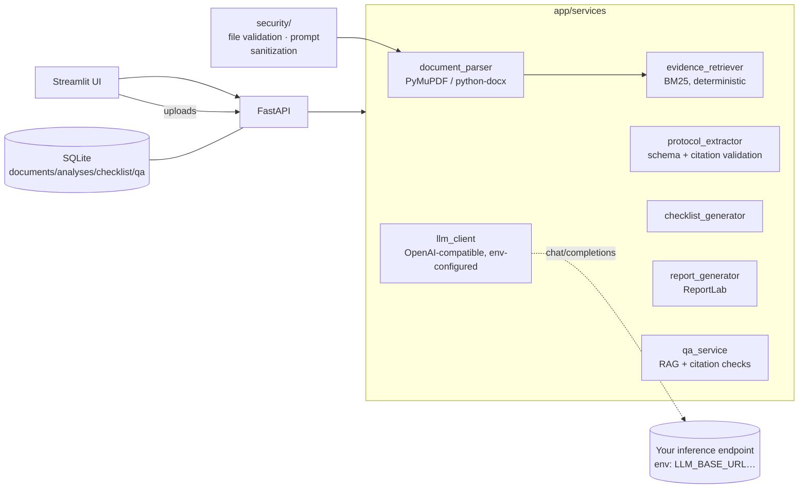

# 🧬 ResearchOps AI Copilot

**Evidence-grounded AI assistance for cancer research operations.**
Upload a research protocol → get structured extraction with citations, a study-startup checklist, cited question-answering, and an executive readiness report.

> Independent demonstration using **synthetic data only**. Not affiliated with or endorsed by any institution. AI output requires review by qualified research personnel; it is not an institutional approval or clinical decision.

## Why this exists

Reviewing a clinical research protocol is a coordination problem as much as a reading problem: research administrators, informatics, regulatory, and clinical teams each need different facts from the same 100-page document, the facts interact (imaging → storage → pipelines → governance), and missing or ambiguous requirements surface late. This tool demonstrates how a language model — constrained to the document, with mandatory citations — can compress that first-pass review from days to minutes while staying auditable.

## What it does

1. **Ingest** — PDF/DOCX upload with type/signature/size validation; text parsed with page-level provenance (chunk ids like `doc-p3-c12`).
2. **Extract** — model-driven structured extraction (Pydantic-validated). Every field carries its supporting chunk ids; unsupported values are dropped, missing values become `Not specified in the protocol`.
3. **Checklist** — startup tasks in five categories, classified as `Protocol Required` (stated in the document), `AI Suggested` (operational hypothesis), or `Needs Clarification` (gap). Editable; CSV-exportable.
4. **Ask** — retrieval-grounded Q&A: only retrieved chunks reach the model, citations are validated against real chunk ids, and answers without support are flagged `insufficient evidence`. General advice is labeled as suggestions, never protocol fact.
5. **Report** — executive PDF: overview, objectives, operational/informatics/technical needs, gaps, checklist summary, risks, source references, human-review requirements. No fabricated readiness score.

## Architecture



Determinism matters: the BM25 index and chunk ids are pure functions of the document, which is what makes citation *validation* (not just citation *formatting*) possible.

## Quick start

```bash
# 1. API
pip install -e .
LLM_BASE_URL=http://your-endpoint/v1 LLM_MODEL=your-model python -m app.main

# 2. UI (second shell)
streamlit run frontend/streamlit_app.py

# 3. Synthetic demo data
python scripts/generate_protocols.py    # writes data/synthetic/*.pdf + ground truth
```

Or `docker compose up --build` (binds to localhost only). The model endpoint is always external and always from env — see `.env.example`.

### 90-second workflow

```bash
curl -F file=@data/synthetic/synthetic_lung_cancer_protocol.pdf localhost:8410/api/documents
curl -X POST localhost:8410/api/documents/<id>/analyze        # extraction + checklist
curl -X POST localhost:8410/api/documents/<id>/ask \
     -H 'Content-Type: application/json' -d '{"question":"What is the planned enrollment?"}'
curl -o report.pdf localhost:8410/api/documents/<id>/report.pdf
curl -X DELETE localhost:8410/api/documents/<id>              # cascade-cleans everything
```

## AI engineering notes

- **Grounding over cleverness. The model only ever sees retrieved excerpts and must cite their ids; the ID space is generated by us, so fake citations are detectable.
- **Structured output with repair, not hope.** One controlled repair (fence-strip / outer-brace slice); beyond that, explicit error. Pydantic re-validates everything.
- **Honest missing data.** Absent facts render as `Not specified in the protocol` — the UI never guesses.
- **Citation ≠ truth. A cited chunk must also lexically support the claim (`verified` flag); unverified citations are labeled in the UI and report.
- **Evaluation. `scripts/evaluate.py` scores extraction against the synthetic ground truth (JSON + Markdown). Measured on this dataset: see `eval_results/summary.md` after running — we publish only measured numbers.

## Security & privacy

Local-only by default, no telemetry, no external calls except the configured model endpoint, uploads treated as untrusted data (never executed), path-safe filenames, secrets only via env. **Not HIPAA-assessed.** Full analysis: `docs/security.md`; prompt-injection defenses and their limits: `docs/ai_governance.md`.

## Production path

`docs/executive_overview.md` (business case) and the phased roadmap with go/no-go gates live in the docs/ — SSO/RBAC, audit logging, encryption, institutional security review, and validated model hosting are the headline gaps between this demo and enterprise reality.

## Repository map

```
app/           FastAPI app: api/ services/ security/ storage/ models/
frontend/      Streamlit dashboard (5 sections)
scripts/       generate_protocols.py · evaluate.py · gb10_bridge.py (local bridge, optional)
tests/         mocked unit/API tests + env-gated live-model integration tests
docs/          architecture · security · ai_governance · deployment · limitations
               executive_overview · demo_script · development_progress
data/synthetic regeneration script output (3 protocols + ground truth)
```

MIT — see `LICENSE`.
